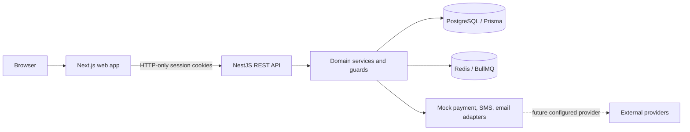

# Architecture

## Decisions

- The web and API are separate packages under `apps/`; the root package owns the lockfile and common commands. Financial logic and authorization remain on the NestJS server.
- PostgreSQL stores the source of truth. Prisma models relational constraints and indexes. Multi-record balance/ledger operations must use database transactions when added.
- Access tokens are short-lived, in HTTP-only cookies. Refresh tokens are random opaque secrets; only an Argon2 hash is stored, and rotation invalidates the previous secret.
- The local payment adapter is an explicit mock; order status begins as `INITIATED`. Only a provider-verified webhook may ever mark production payments successful.
- Users can access only records whose user/owner ID matches the authenticated subject. Team views return aggregates and limited member identifiers.
- Redis stores BullMQ mock-provider jobs. The worker simulates asynchronous local payment status updates; it never contacts a production payment service.
- UI view state is local React state. Sensitive tokens, passwords, financial details, and account identifiers must not be stored in local storage.

## Data domains

`User` owns `RefreshSession`, `Wallet`, `DepositOrder`, `LedgerEntry`, and `UpiAccount` records. Password and PIN credentials are stored only as Argon2 hashes. `TeamMember` relates an owner to another user and stores only aggregate recharge/commission amounts. Currency, order status, UPI state, and ledger type use enums to limit invalid transitions.

## Trust boundaries

The browser is untrusted. DTO validation and authorization run in the API. Deposit total/rate/bonus values are calculated server-side. Account scope is part of each database query. Provider callbacks must be authenticated and idempotent before changing order state. Development credentials and mock providers are never for production.
